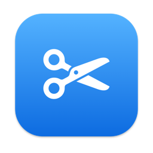

<div align="center">



# EZSnap

**Grab part of the screen, mark it up, paste it.**

A small screenshot and annotation tool for macOS (menu bar) and Windows 10/11
(system tray). Hover to pick a window or drag a region, annotate it in place, then copy, save or pin it.

[](#macos)
[](#windows)
[](#development)
[](windows/README.md)
[](LICENSE)

**English** · [简体中文](README.zh-CN.md)

</div>

> **Status: early.** [0.2.1](../../releases/latest) is the latest release, with installers for both
> systems. The Mac version runs on macOS 26 (Apple Silicon); the Intel build has only been run under
> Rosetta. The Windows version has passed its self-test, including a real screen capture, on GitHub's
> Windows runners, but has not yet been tried on a real Windows 10 PC. Neither is signed with a
> certificate the system trusts (the Mac app is self-signed and not notarized; the Windows installer
> is unsigned), so both systems warn on first launch.

---

## Why EZSnap

- **One shortcut, then everything happens on the screen.** No window to open and no file to name:
  the screen freezes, you pick what you want, mark it up and press Enter. It's on the clipboard.
- **Windows are picked for you.** Hovering highlights the window under the mouse; a single click
  selects all of it, even when it spans two screens.
- **Annotate before you share.** Rectangles, ellipses, arrows, pen, text and mosaic, drawn directly
  on the frozen screen. Marks stay adjustable after you draw them, and every change can be undone.
- **Small and local.** No third-party libraries and no account. The only network access is the
  update check, which you can turn off. Settings stay on your computer.

---

## Features

### Capture
- Hover to highlight a window, click to select it; with no window under the mouse, the whole screen
- Drag to select a region, across screens if you like; drag inside to move it, drag the edges or
  corners to resize
- A magnifier shows the coordinates and color under the mouse: `C` copies the color, `Shift`
  switches between RGB and HEX
- The selection size is shown above its corner

### Annotate
- Rectangle, ellipse, arrow, pen, text and mosaic
- Three sizes and eight colors
- Rectangles, ellipses and arrows stay adjustable: click a line to select it, then drag to move it,
  drag its handles to resize it, or press `Delete`
- Text and pen strokes can be moved too; double-click text to edit it
- With a mark selected, the size and color buttons change that mark
- `⌘Z` / `Ctrl+Z` steps back through every change: drawing, moving, resizing, restyling, deleting

### Finish
- Copy to the clipboard: double-click the selection, press `Enter`, or `⌘C` / `Ctrl+C`
- Save as PNG: `⌘S` / `Ctrl+S` or the save button. The file name defaults to the date and time
- Pin: keep the shot on top of every window. Drag to move, scroll to zoom, double-click or `Esc` to
  close, right-click to copy or save

### Shortcut and language
- The capture shortcut can be one of three presets or any combination you record
- English, 简体中文 and 繁體中文, or follow the system. A change applies at once, no restart
- Tells you when a new version is on GitHub and opens the release page to download it. The check can
  be turned off

---

## Install

Download the installer for your system from [Releases](../../releases/latest).

### macOS

Requires macOS 14 or later, on Apple Silicon or Intel.

1. Open `EZSnap-<version>.dmg` and drag **EZSnap** onto **Applications**.
2. Open EZSnap from Launchpad or Spotlight. The app isn't notarized, so the first time macOS blocks
   it: click **Done**, go to **System Settings → Privacy & Security**, click **Open Anyway** next to
   the message about EZSnap, and open it again. (On macOS 14 you can instead Control-click the app
   and choose **Open**.) This is needed once per download.

EZSnap has no window and no Dock icon: it lives in the menu bar as a pair of scissors, and shows a
short hint the first time it opens.

**Screen recording permission.** macOS asks for it on the first capture. Turn on EZSnap under
**System Settings → Privacy & Security → Screen & System Audio Recording**, then quit EZSnap (menu
bar scissors → Quit) and open it again.

To start it at login, add EZSnap under **System Settings → General → Login Items**.

To upgrade, quit EZSnap and drag the new version onto **Applications**, replacing the old one.
Releases after 0.2.0 are all signed with the same self-signed certificate, so macOS should keep the
screen recording permission; coming from 0.2.0 or earlier, you need to grant it once more (see
[FAQ](#faq)).

### Windows

Requires Windows 10 version 1903 or later, or Windows 11. .NET Framework 4.8 is built in, so
nothing else needs to be installed.

Run `EZSnap-Setup-<version>.exe`. The installer is unsigned, so Windows shows "Windows protected
your PC": click **More info → Run anyway**.

It installs for the current user under `%LOCALAPPDATA%\Programs\EZSnap`, with no administrator
rights. EZSnap appears in the Start menu and as a pair of scissors in the system tray (it may be
hidden under **^**). Uninstall it from **Settings → Apps**. Windows needs no screen recording
permission.

More about the Windows version: [windows/README.md](windows/README.md) (Chinese).

### Build from source (macOS)

Needs the Command Line Tools (`xcode-select --install`); Xcode itself isn't needed.

```bash
git clone <repository URL>
cd EZSnap
./scripts/install.sh
```

This builds the app for your Mac and installs it to `/Applications/EZSnap.app`, the same place as
dragging it in from the DMG. It needs an administrator account (no password prompt) and removes an
older copy in `~/Applications` if there is one. A build you make yourself isn't quarantined, so macOS
doesn't block it.

---

## Usage

| Action | macOS | Windows |
|---|---|---|
| Start a capture | `⌃⌘A` | `Ctrl+Alt+A` |
| Other shortcut presets | `⌥A`, `⇧⌘A` | `Alt+A`, `Ctrl+Shift+A` |
| Pick a window | Hover, then click | Same |
| Select a region | Drag, across screens if needed | Same |
| Move / resize the selection | Drag inside / drag edges and corners (once you've drawn on it, it can be resized but not moved) | Same |
| Copy the color under the mouse | `C`; `Shift` switches RGB / HEX | Same |
| Copy and finish | Double-click the selection, `Enter` or `⌘C` | Double-click, `Enter` or `Ctrl+C` |
| Save as PNG | `⌘S` or the save button | `Ctrl+S` or the save button |
| Select a drawn mark | Click its line, or the text | Same |
| Move / resize a mark | Drag it / drag its handles | Same |
| Edit text | Double-click it | Same |
| Delete the selected mark | `Delete` | Same |
| Undo | `⌘Z` | `Ctrl+Z` |
| Pin to the screen | Pin button | Same |
| Cancel the selection | Right-click | Same |
| Quit the capture | `Esc` (or right-click with no selection) | Same |
| Change the shortcut | Menu bar → Shortcut → a preset or Custom… | Tray menu → Shortcut |
| Change the language | Menu bar → Language | Tray menu → Language |
| Check for updates | Menu bar → Check for Updates… | Tray menu → Check for Updates… |

With the pen or mosaic tool on, clicks always draw; turn the tool off to select a mark. Mosaic can't be
moved once drawn.

In the text tool, `⌘X` `⌘C` `⌘V` `⌘A` `⌘Z` (the `Ctrl` versions on Windows) edit the text as
usual; `Enter` or `Esc` ends typing.

---

## FAQ

<details>
<summary><b>Screen recording is on for EZSnap, but it keeps asking for permission</b></summary>

The EZSnap entry in the permission list was left by an earlier version. Up to 0.2.0 the app was
signed without a certificate, so macOS tied the permission to that exact build; the list still shows
the old entry as on, but it doesn't count for the new version. Fix it once:

1. Click **Reset Permission** in EZSnap's permission alert (versions after 0.2.0), or select EZSnap
   in **System Settings → Privacy & Security → Screen & System Audio Recording** and click **−**.
2. Open EZSnap, turn it on when asked, then quit and reopen EZSnap.

Releases after 0.2.0 are all signed with the same certificate, so later updates should keep the
permission.

If you build it yourself, create a self-signed certificate once; `build.sh` then signs with it and
rebuilds keep the permission. Without it, every build is ad-hoc signed and needs permission again.
Switching between your own builds and downloaded releases also needs it again, because the
certificates differ.

```bash
./scripts/make-signing-cert.sh   # adds "EZSnap Code Signing" to your login keychain
```
</details>

<details>
<summary><b>The shortcut doesn't work</b></summary>

Another app may already use it; the menu then says *Shortcut (registration failed, may be in use)*.
Pick another preset or record your own under **Shortcut → Custom…**. The recorder refuses
combinations that would take over everyday shortcuts, such as `⌘` alone on the Mac or `Ctrl` alone
on Windows. Function keys (F1–F20 on the Mac, F1–F24 on Windows) can be used on their own.
</details>

<details>
<summary><b>What does EZSnap store, and does it send anything?</b></summary>

The only connection is the update check: at launch and then once a day, EZSnap asks GitHub for the
version number of the latest release. Nothing else is sent. Turn off *Check for Updates
Automatically* in the menu to stop it; *Check for Updates…* then connects only when you click it.

It stores only the chosen shortcut, the language, the last folder you saved to and the update-check
settings:

- **macOS:** the app's preferences (`~/Library/Preferences/local.ezsnap.app.plist`)
- **Windows:** `%APPDATA%\EZSnap\settings.txt`, which the uninstaller leaves in place

Screenshots go only to the clipboard, or to the file you choose.
</details>

---

## Known limitations

- **No trusted signature.** The Mac app is self-signed, not signed with a Developer ID, and isn't
  notarized; the Windows installer is unsigned. Gatekeeper and SmartScreen warn on first launch;
  distributing to others properly needs a Developer ID (Mac) and a code-signing certificate (Windows).
- **No long screenshots, OCR or screen recording.** These are out of scope.
- **No start-at-login setting.** Add EZSnap to the system's login items yourself.
- **A pin spanning two Mac screens shows on only one of them** when *Displays have separate Spaces*
  is on, which is the macOS default.
- **Windows:** the text box is dark gray while you type (WinForms text boxes can't be transparent);
  the installer is in English only.

---

## Development

```bash
./scripts/build.sh                                       # build/EZSnap.app only, no install
./scripts/package-mac.sh                                 # dist/EZSnap-<version>.dmg, Apple Silicon + Intel (needs the signing certificate)
build/EZSnap.app/Contents/MacOS/EZSnap --selftest /tmp   # self-test, writes PNGs to /tmp
build/EZSnap.app/Contents/MacOS/EZSnap --check-update     # ask GitHub for the latest release once
swift scripts/make-icon.swift Resources/AppIcon.icns     # regenerate the Mac icon
swift scripts/make-icon.swift windows/EZSnap/AppIcon.ico # regenerate the Windows icon
```

The self-test needs no screen recording permission. It drives a capture session with synthetic
images and writes the overlay and the exported result as PNGs. It covers drawing, export and the
editing logic (by calling the session's mouse and keyboard methods directly), not screen capture,
the shortcut or real mouse and keyboard events. Pushes that touch the Mac sources run
[.github/workflows/macos.yml](.github/workflows/macos.yml) on a macOS runner: a build for Apple
Silicon and Intel, then the self-test, with its log and PNGs as an artifact.

The Windows version builds with `dotnet build windows/EZSnap/EZSnap.csproj -c Release`, on a Mac
too, though it only runs on Windows. Pushes that touch `windows/` run
[.github/workflows/windows.yml](.github/workflows/windows.yml) on a Windows runner: build,
self-test (including one real capture), and the Inno Setup installer as an artifact. Details are in
[windows/README.md](windows/README.md). The version number is set in `Resources/Info.plist` (Mac),
`windows/EZSnap/EZSnap.csproj` and `windows/installer/EZSnap.iss` (Windows).

<details>
<summary><b>Project layout</b></summary>

| Path | What it is |
|---|---|
| `Sources/EZSnap/AppDelegate.swift` | Menu bar icon and menu, shortcut choice, the hidden main menu that dispatches `⌘` shortcuts, the capture flow, pins |
| `Sources/EZSnap/HotKey.swift` | Global shortcut (Carbon `RegisterEventHotKey`, needs no Accessibility permission) and the shortcut model |
| `Sources/EZSnap/HotKeyRecorder.swift` | The small window that records a custom shortcut |
| `Sources/EZSnap/Capture.swift` | ScreenCaptureKit capture, the window list, copy and save |
| `Sources/EZSnap/CaptureSession.swift` | One capture: an overlay per screen, with the selection, marks and toolbar shared across screens; stitches the screens on export |
| `Sources/EZSnap/OverlayView.swift` | One screen's overlay: draws its part and the magnifier, passes mouse and keyboard to the session |
| `Sources/EZSnap/Annotation.swift` | Annotation model, drawing and pen styles |
| `Sources/EZSnap/ToolbarView.swift` | Toolbar and the size / color panel |
| `Sources/EZSnap/PinWindow.swift` | Pinned screenshots |
| `Sources/EZSnap/L10n.swift` | Interface languages |
| `Sources/EZSnap/UpdateChecker.swift` | Checking GitHub for a new version |
| `Sources/EZSnap/SelfTest.swift` | Self-test |
| `scripts/` | `build.sh`, `install.sh`, `package-mac.sh` (the DMG), `make-signing-cert.sh`, the icon generator |
| `windows/` | The Windows version (C#, WinForms) and its installer script |
| `docs/` | Project notes, [decisions](docs/decisions.md) and [pitfalls](docs/pitfalls.md), in Chinese |

</details>

---

## License

[MIT](LICENSE)
