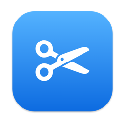

<div align="center">



# EZSnap

**框一块屏幕，标注一下，粘贴出去。**

轻巧的截图标注小工具，有 macOS 版（菜单栏）和 Windows 10/11 版（系统托盘）。悬停选窗口或拖动框选，
在原地标注，然后复制、保存或钉在屏幕上。

[](#macos)
[](#windows)
[](#开发)
[](windows/README.md)
[](LICENSE)

[English](README.md) · **简体中文**

</div>

> **状态：早期。** Mac 版 0.1.0、Windows 版 0.1.1，都从源码构建，还没有发布正式版本。
> Mac 版在 macOS 26（Apple Silicon）上运行。Windows 版在 GitHub 的 Windows 机器上通过了自检
> （包括一次真实截屏），还没在真实的 Windows 10 电脑上试过。两个版本都没有签名，第一次打开时系统会提示。

---

## 为什么用 EZSnap

- **按一下快捷键，剩下的都在屏幕上完成。** 不用开窗口、不用起文件名：屏幕定格，选好范围，标注，按回车，
  图就在剪贴板里了。
- **窗口自动识别。** 鼠标悬停高亮所在的窗口，单击整个选中，横跨两块屏的窗口也一样。
- **分享前先标注。** 矩形、椭圆、箭头、画笔、文字、马赛克，直接画在定格的屏幕上，可以撤销。
- **小巧、只在本机。** 不依赖第三方库，不用账号，不联网。设置只存在你自己的电脑上。

---

## 功能

### 截图
- 悬停高亮窗口，单击选中；鼠标下没有窗口时选中整块屏幕
- 拖动框选区域，可以跨屏；拖选区内部移动，拖边和角调整大小
- 放大镜显示鼠标处的坐标和颜色：`C` 复制颜色值，`Shift` 切换 RGB / HEX
- 选区左上角上方显示尺寸

### 标注
- 矩形、椭圆、箭头、画笔、文字、马赛克
- 粗细 3 档，颜色 8 种
- `⌘Z` / `Ctrl+Z` 撤销上一个标注

### 完成
- 复制到剪贴板：双击选区、按 `Enter`，或 `⌘C` / `Ctrl+C`
- 另存为 PNG：`⌘S` / `Ctrl+S` 或保存按钮，默认文件名是日期和时间
- 钉图：把截图钉在所有窗口最上层。拖动移动，滚轮缩放，双击或 `Esc` 关闭，右键菜单可复制、另存

### 快捷键与语言
- 截图快捷键可以选三个预设之一，也可以录制任意组合键
- English、简体中文、繁體中文，或跟随系统，切换后立即生效，不用重启

---

## 安装

### macOS

需要 macOS 14 及以上和 Command Line Tools（`xcode-select --install`），不需要 Xcode。

```bash
git clone <仓库地址>
cd EZSnap
./scripts/install.sh
```

它会构建 app 并装到当前用户的 `~/Applications/EZSnap.app`，不需要管理员密码。之后在启动台、
Spotlight 或 Finder 里打开。EZSnap 没有窗口和 Dock 图标，只在菜单栏放一个剪刀图标，第一次打开时会弹出简短提示。

**屏幕录制权限。** 第一次截图时 macOS 会要求授权：在 **系统设置 → 隐私与安全性 → 屏幕与系统录音**
里打开 EZSnap，然后退出 EZSnap（菜单栏剪刀图标 → 退出）再重新打开。

想开机自动运行，在 **系统设置 → 通用 → 登录项** 里添加 EZSnap。

### Windows

需要 Windows 10 1903 及以上或 Windows 11。系统自带 .NET Framework 4.8，不用另装运行时。

1. 在 GitHub 上打开本仓库的 **Actions → Windows**，选最近一次成功的运行，下载 `EZSnap-windows`。
2. 解压后运行 `EZSnap-Setup-版本号.exe`。安装包没有签名，Windows 会提示“Windows 已保护你的电脑”：
   点 **更多信息 → 仍要运行**。

装在当前用户的 `%LOCALAPPDATA%\Programs\EZSnap`，不需要管理员权限。开始菜单里有 EZSnap，
右下角托盘里有剪刀图标（可能收在 **^** 里）。卸载在 **设置 → 应用**。Windows 版不需要屏幕录制权限。

Windows 版的更多说明见 [windows/README.md](windows/README.md)。

---

## 用法

| 操作 | macOS | Windows |
|---|---|---|
| 开始截图 | `⌃⌘A` | `Ctrl+Alt+A` |
| 其他预设快捷键 | `⌥A`、`⇧⌘A` | `Alt+A`、`Ctrl+Shift+A` |
| 选窗口 | 悬停后单击 | 同左 |
| 框选区域 | 拖动，可以跨屏 | 同左 |
| 移动 / 调整选区 | 拖内部 / 拖边和角（有标注后只能调整大小，不能移动） | 同左 |
| 复制鼠标处的颜色 | `C`；`Shift` 切换 RGB / HEX | 同左 |
| 复制并完成 | 双击选区、`Enter` 或 `⌘C` | 双击、`Enter` 或 `Ctrl+C` |
| 另存为 PNG | `⌘S` 或保存按钮 | `Ctrl+S` 或保存按钮 |
| 撤销上一个标注 | `⌘Z` | `Ctrl+Z` |
| 钉在屏幕上 | 钉图按钮 | 同左 |
| 取消选区 | 右键 | 同左 |
| 退出截图 | `Esc`（没有选区时右键也行） | 同左 |
| 改快捷键 | 菜单栏 → 快捷键 → 预设或“自定义…” | 托盘菜单 → 快捷键 |
| 改语言 | 菜单栏 → 语言 / Language | 托盘菜单 → 语言 / Language |

文字工具的输入框里，`⌘X` `⌘C` `⌘V` `⌘A` `⌘Z`（Windows 上是对应的 `Ctrl` 组合）是普通的文字编辑；
`Enter` 或 `Esc` 结束输入。

---

## 常见问题

<details>
<summary><b>重新编译后，macOS 又要我授权屏幕录制</b></summary>

app 用的是 ad-hoc 签名，每次编译签名都会变，系统把每次的构建当成新应用。在权限列表里删掉旧的 EZSnap
再重新加。想避免这一点，在 **钥匙串访问 → 证书助理 → 创建证书** 建一个“代码签名”类型的自签名证书，
然后用它构建：

```bash
SIGN_IDENTITY="证书名称" ./scripts/install.sh
```
</details>

<details>
<summary><b>快捷键没反应</b></summary>

可能被别的应用占用了，这时菜单里会显示“快捷键（注册失败，可能被占用）”。换一个预设，或在
**快捷键 → 自定义…** 里录一个。会抢走常用快捷键的组合录不进去，比如 Mac 上只带 `⌘`、Windows 上只带
`Ctrl` 的。功能键（Mac 上 F1–F20，Windows 上 F1–F24）可以单独用。
</details>

<details>
<summary><b>EZSnap 存了什么，会往外发数据吗？</b></summary>

不联网。只存选的快捷键、界面语言和上次保存的文件夹：

- **macOS：** app 的偏好设置（`~/Library/Preferences/local.ezsnap.app.plist`）
- **Windows：** `%APPDATA%\EZSnap\settings.txt`，卸载时不删

截图只进剪贴板，或存到你选的文件里。
</details>

---

## 已知限制

- **没有签名和公证。** 第一次打开时 Gatekeeper、SmartScreen 会拦；正式发给别人用，需要 Apple 的
  Developer ID 和 Windows 的代码签名证书。
- **还没有发布版本。** 两个版本都要从源码构建，或从 CI 的运行结果里下载。
- **不做长截图、OCR、录屏。**
- **没有“开机启动”开关。** 需要自己加到系统的登录项里。
- **Mac 上横跨两块屏的钉图只显示在其中一块上**（系统设置里“显示器具有单独的空间”打开时，这是默认设置）。
- **Windows：** 输入文字时输入框是深灰底（WinForms 的输入框不能透明）；安装程序界面只有英文。

---

## 开发

```bash
./scripts/build.sh                                       # 只生成 build/EZSnap.app，不安装
build/EZSnap.app/Contents/MacOS/EZSnap --selftest /tmp   # 自检，PNG 写到 /tmp
swift scripts/make-icon.swift Resources/AppIcon.icns     # 重新生成 Mac 图标
swift scripts/make-icon.swift windows/EZSnap/AppIcon.ico # 重新生成 Windows 图标
```

自检不需要屏幕录制权限：用合成图片驱动一次截图，把遮罩界面和导出结果写成 PNG。只覆盖绘制和导出，
不覆盖截屏、快捷键和鼠标键盘交互。

Windows 版用 `dotnet build windows/EZSnap/EZSnap.csproj -c Release` 构建，在 Mac 上也能编译，
但只能在 Windows 上运行。每次推送都会在 Windows 机器上跑
[.github/workflows/windows.yml](.github/workflows/windows.yml)：构建、自检（包括一次真实截屏）、
用 Inno Setup 打安装包并上传。详见 [windows/README.md](windows/README.md)。

<details>
<summary><b>目录结构</b></summary>

| 路径 | 内容 |
|---|---|
| `Sources/EZSnap/AppDelegate.swift` | 菜单栏图标和菜单、快捷键选择、分发 `⌘` 快捷键的隐藏主菜单、截图流程、钉图管理 |
| `Sources/EZSnap/HotKey.swift` | 全局快捷键（Carbon `RegisterEventHotKey`，不需要辅助功能权限）、快捷键模型 |
| `Sources/EZSnap/HotKeyRecorder.swift` | 录制自定义快捷键的小窗口 |
| `Sources/EZSnap/Capture.swift` | ScreenCaptureKit 截屏、窗口列表、复制和保存 |
| `Sources/EZSnap/CaptureSession.swift` | 一次截图：每块屏一个遮罩，选区、标注、工具条跨屏统一管理，导出时拼接各屏 |
| `Sources/EZSnap/OverlayView.swift` | 一块屏的遮罩：画本屏的部分和放大镜，把鼠标键盘事件交给会话 |
| `Sources/EZSnap/Annotation.swift` | 标注模型和绘制、画笔样式 |
| `Sources/EZSnap/ToolbarView.swift` | 工具条和粗细 / 颜色面板 |
| `Sources/EZSnap/PinWindow.swift` | 钉图窗口 |
| `Sources/EZSnap/L10n.swift` | 界面语言 |
| `Sources/EZSnap/SelfTest.swift` | 自检 |
| `scripts/` | `build.sh`、`install.sh`、图标生成脚本 |
| `windows/` | Windows 版（C#、WinForms）和安装包脚本 |
| `docs/` | 项目笔记、[决策](docs/decisions.md)和[踩过的坑](docs/pitfalls.md) |

</details>

---

## 许可证

[MIT](LICENSE)
